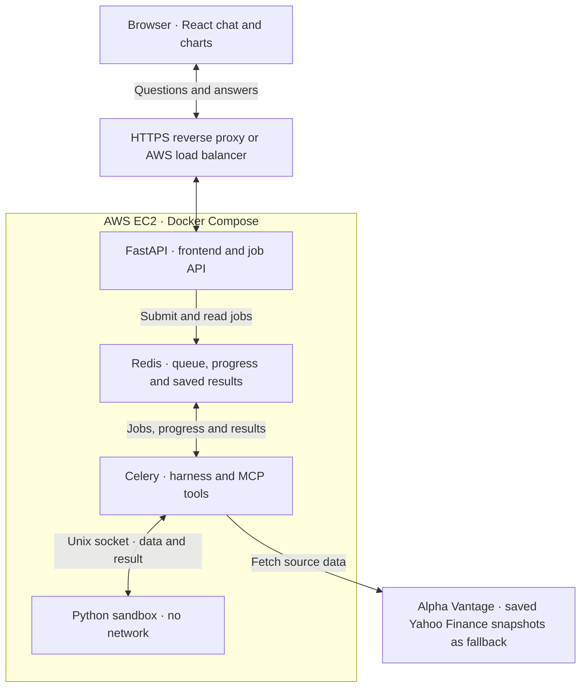

# Financial Harness architecture

The local and cloud demo can use the same Compose services. The AWS-style layout shows a possible EC2 deployment. The local stack starts without AWS.

Redis stores job results for up to 24 hours. The calculation service runs as a non-root user with a read-only image, a memory limit, and a per-calculation timeout. Provider calls stay in the worker.
